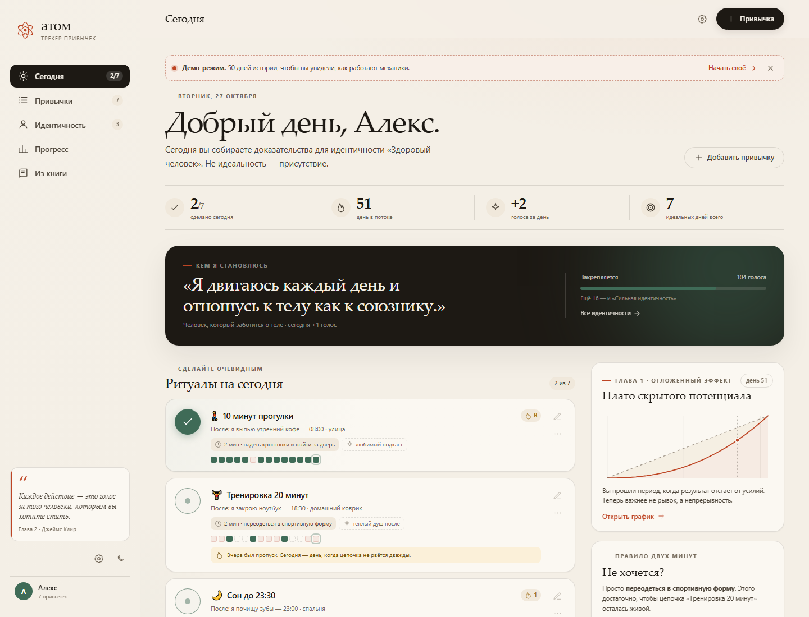
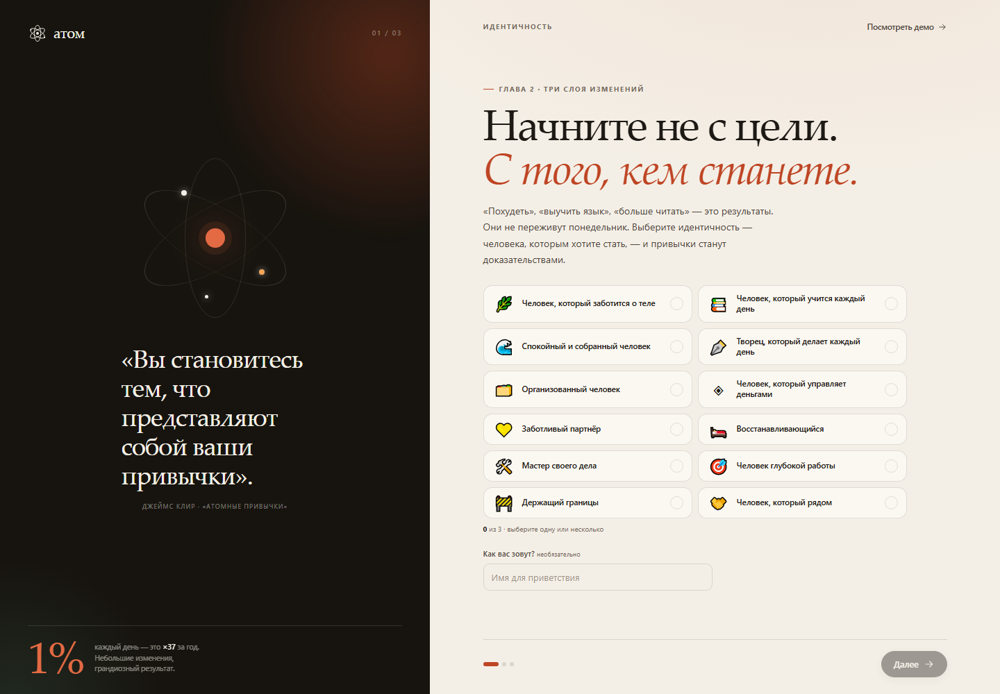
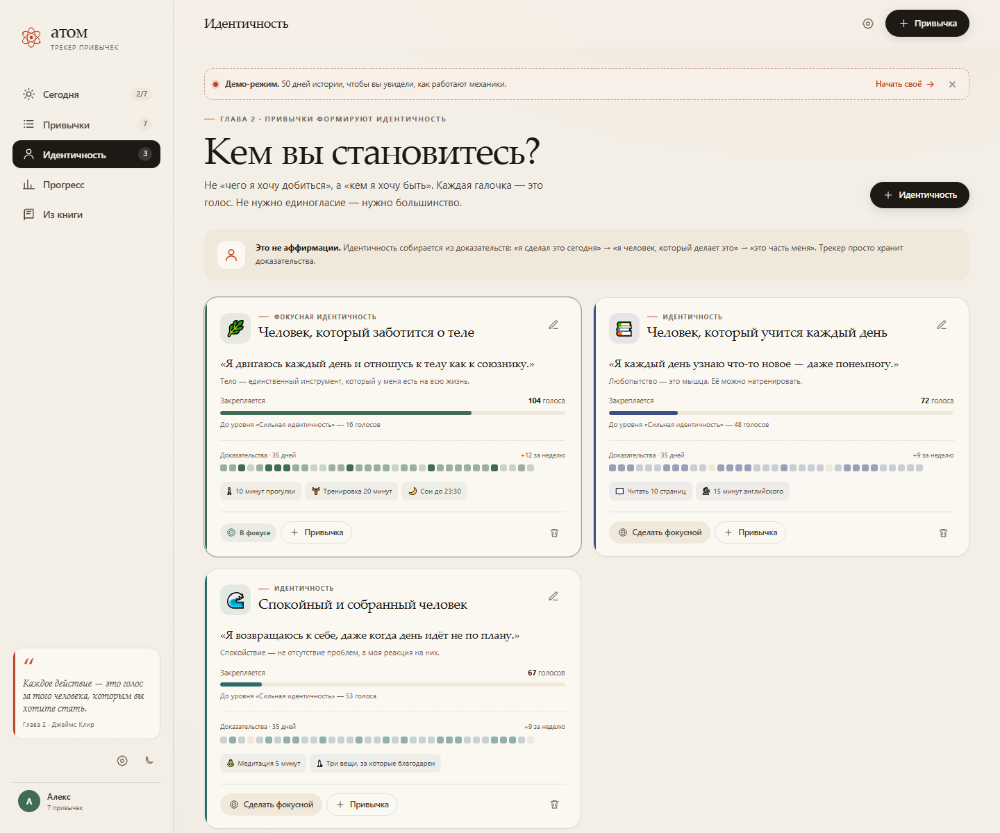
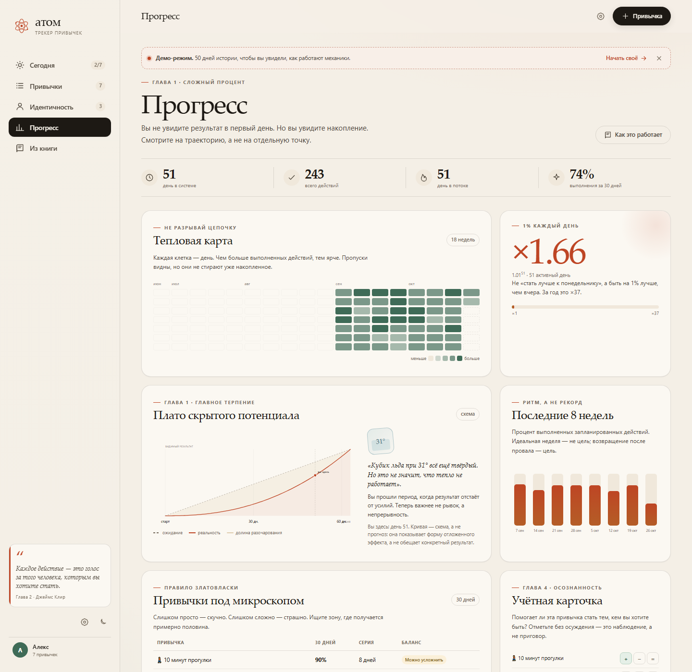
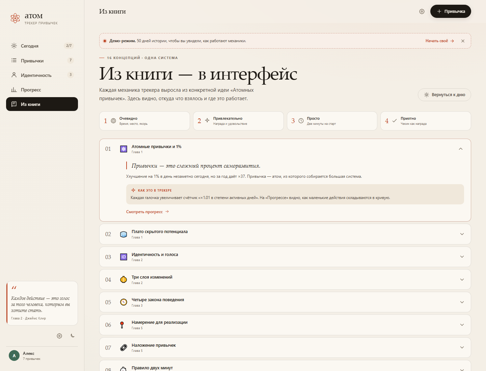

# АТОМ — трекер привычек по книге «Атомные привычки»

> «Вы становитесь тем, что представляют собой ваши привычки».
> Джеймс Клир

**АТОМ** — это не список галочек, а трекер идентичности. Он спрашивает не «что ты сделал?», а «кем ты становишься?». Каждая привычка привязана к идентичности, каждый чекин добавляет голос, а прогресс показывает не только результат, но и плато, на котором результат ещё не виден.



---

## Быстрый старт

1. Откройте `index.html` в Chrome, Edge или Safari. Сервер не нужен: это статическая страница.
2. Пройдите три шага онбординга: выберите 1–3 идентичности, соберите первый стек привычек, начните.
3. Или нажмите **«Посмотреть демо»** — загрузится 50 дней истории, чтобы сразу увидеть все механики.

Демо можно открыть и напрямую:

```text
index.html?demo=1
```

Все данные хранятся **только в вашем браузере** (`localStorage`). Никакой регистрации, сервера и аналитики.

---

## Экраны

| Экран | Что там |
|---|---|
| **Сегодня** | Идентичность дня, ритуалы, кнопка «2 мин», предупреждение «не пропускай дважды», мини-график плато, цитата |
| **Привычки** | Стек дня по времени, все привычки, архив, настройка якорей, наград, среды и контракта |
| **Идентичность** | Карточки идентичностей, уровни, голоса, 35-дневная лента доказательств, фокусная идентичность |
| **Прогресс** | Тепловая карта, ×1.01, плато скрытого потенциала, недельный ритм, таблица Златовласки, аудит привычек |
| **Из книги** | 16 концепций: откуда взялась каждая механика и где она живёт |
| **Настройки** | Имя, тема, экспорт/импорт JSON, демо, сброс |

### Скриншоты

| Онбординг | Идентичность |
|---|---|
|  |  |

| Прогресс | Из книги |
|---|---|
|  |  |

Мобильная версия: [screenshots/mobile.png](screenshots/mobile.png).  
Библиотека идентичностей: [screenshots/library.png](screenshots/library.png).

### Библиотека идентичностей

В онбординге доступно **12 шаблонов**; выбрать можно до трёх — это осознанное ограничение, чтобы голоса не размывались между десятком «я».

- **Тело и энергия:** Человек, который заботится о теле · Восстанавливающийся
- **Разум и работа:** Человек, который учится каждый день · Творец, который делает каждый день · Мастер своего дела · Человек глубокой работы
- **Эмоции и отношения:** Спокойный и собранный человек · Держащий границы · Заботливый партнёр · Человек, который рядом
- **Дом и деньги:** Организованный человек · Человек, который управляет деньгами

Добавленные идентичности: **Восстанавливающийся** (сон, паузы, профилактика выгорания), **Мастер своего дела** (глубина и качество в профессии), **Человек глубокой работы** (защита фокуса), **Держащий границы** («нет» без чувства вины) и **Человек, который рядом** (связи с близкими как ежедневная практика). У каждой — три готовые привычки с якорями, двухминутными версиями и наградой.

---

## Карта идей

Подробное описание — в [ИДЕИ.md](ИДЕИ.md). Коротко:

| Идея из книги | Где в трекере | Как выглядит |
|---|---|---|
| Идентичность и «голоса» (гл. 2) | Онбординг, «Идентичность», баннер на главной | Уровни от «Первого голоса» до «Это уже вы», шкала, лента доказательств |
| Плато скрытого потенциала (гл. 1) | «Прогресс», правая колонка «Сегодня» | Две кривые, «долина разочарования», маркер «вы здесь», кубик льда 31° |
| Сложный процент 1% (гл. 1) | «Прогресс» | `×1.66`, формула `1.01^51`, шкала ×1 → ×37 |
| Правило двух минут (гл. 13) | Карточка привычки | Кнопка «2 мин · надеть кроссовки», цепочка сохраняется |
| Никогда не пропускай дважды (гл. 16) | Карточка привычки | Янтарная/красная/зелёная плашка и мягкий перезапуск |
| Не разрывай цепочку (гл. 16) | «Прогресс», карточки | Тепловая карта 18 недель, серия `🔥`, 14 мини-дней |
| Наложение привычек (гл. 5) | Форма и «Стек привычек» | «После: …», вертикальная лента утро → вечер |
| Четыре закона (гл. 3) | Форма привычки | Четыре секции с бейджами «Закон 1–4» и живой предпросмотр |
| Дизайн среды (гл. 6) | Расширенные настройки, детали | Поле «Подготовка среды», готовые подсказки в шаблонах |
| Награда и контракт (гл. 8, 17) | Форма, детали | Плашка «🎧 подкаст», партнёр и ставка |
| Правило Златовласки (гл. 19) | «Прогресс» | Бейджи «Усложнить / В балансе / Сделать проще» |
| Учётная карточка (гл. 4) | «Прогресс» | Аудит `+ − =` и сводка «работают / тормозят / нейтральны» |
| Немедленное вознаграждение (гл. 15) | Везде | «+1», тосты, конфетти, «Идеальный день» |

---

## Как считаются механики

### Голоса и уровни
- Полный чекин = 1 голос, двухминутная версия = 1 голос.
- Уровни идентичности: `0 → 1 → 5 → 15 → 30 → 60 → 120 → 240 → 500` голосов.
- Названия: Первый голос, Искра, Набирает силу, Формируется, Большинство, Закрепляется, Сильная идентичность, Это уже вы, Глубокая идентичность.
- Голоса не отменяются пропусками. Пропуск — не голос против; он просто не добавляет голос.

### Серии и «не пропускай дважды»
- Серия привычки считается по запланированным дням; дни вне расписания пропускаются.
- `missRun` — сколько запланированных дней подряд пропущено до сегодня. `1` → янтарное предупреждение, `≥2` → красное «пора вернуться».
- Если сегодня отметить привычку после пропуска, карточка показывает восстановление.

### Плато
- «Вы здесь» — день с момента старта.
- Кривая «реальность» — иллюстративная S-кривая, а не прогноз; в интерфейсе это явно написано.
- Текст плато меняется по мере дней: начало → долина → «плато работает на вас» → «важнее непрерывность».

### 1% и Златовласка
- `×1.01^активных_дней`; активный день — день хотя бы с одним чекином.
- Процент выполнения считается за 30 завершённых дней (сегодня не штрафует).
- `≥85%` → «Можно усложнить», `≤50%` → «Сделайте проще», между → «В балансе».

---

## Данные и приватность

- Всё лежит в `localStorage` под ключом `atom-habits-v1`.
- **Настройки → Скачать JSON** делает резервную копию.
- **Загрузить JSON** заменяет текущие данные.
- **Сбросить всё** удаляет состояние и возвращает онбординг.
- Демо-режим можно отключить кнопкой «Начать своё» в верхней плашке.

> Данные привязаны к браузеру и профилю. При переходе на другое устройство используйте экспорт/импорт.

---

## Структура проекта

```text
AtomicTrecker/
├── index.html          # точка входа
├── assets/
│   ├── data.js         # идентичности, шаблоны привычек, цитаты, 16 концепций
│   ├── app.js          # состояние, роутинг, экраны, графики, модальные окна
│   └── styles.css      # дизайн-система, тёмная тема, адаптивность
├── screenshots/        # скриншоты для документации
├── ИДЕИ.md             # 13 идей: как выглядят и почему работают
└── README.md
```

---

## Что можно добавить дальше

- Еженедельный обзор в воскресенье.
- PWA-режим и локальные напоминания.
- Совместный контракт с партнёром по ссылке.
- Экспорт привычек в календарь.
- Режим «минимальной недели» для сложных периодов.

---

## Источник

Книга: **Джеймс Клир, «Атомные привычки. Как приобрести хорошие привычки и избавиться от плохих»** (James Clear, *Atomic Habits*, 2018).

Приложение — самостоятельная интерфейсная интерпретация идей книги, а не официальный продукт автора или издательства. Короткие цитаты использованы как опоры для механик; для полного контекста читайте книгу.
